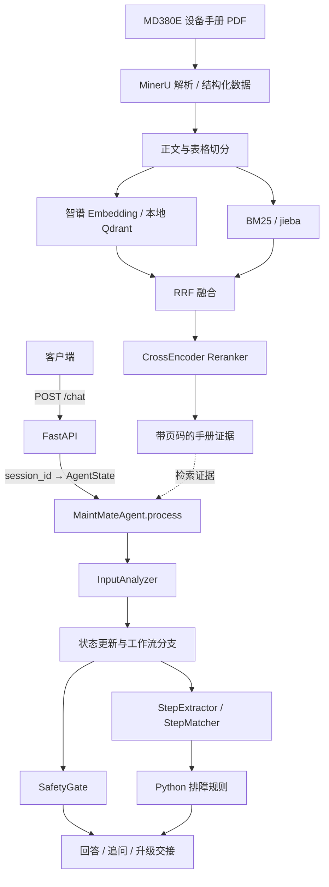

# MaintMate 🔧

**基于 RAG 与 Agent 的工业设备运维辅助系统**

面向工业设备技术手册的故障知识检索、多轮排障记录与技术支持交接原型。

<p align="center">
  
  
  
  
  
</p>

> ⚠️ **当前范围：** 主要使用《MD380E 系列专用变频器用户手册》构建和验证。这是一个辅助诊断原型，**不直接控制设备、不执行维修操作，也不会自动联系厂家**。

---

## 📑 目录

- [项目背景](#1-项目背景)
- [已实现功能](#2-已实现功能)
- [系统架构](#3-系统架构)
- [技术栈](#4-技术栈)
- [项目结构](#5-项目结构)
- [本地运行](#6-本地运行)
- [测试与评估](#7-测试与评估)
- [当前限制与安全说明](#8-当前限制与安全说明)
- [公开仓库前的检查](#9-公开仓库前的检查)

---

## 1. 项目背景

工业设备故障处理通常需要反复查阅用户手册、核对故障代码，并根据已经完成的检查逐步排查。单轮 RAG 可以帮助定位手册知识，但难以持续追踪「当前是什么故障、检查过哪些项目、下一步还需要确认什么」。

MaintMate 将设备手册 RAG 与有状态的 Agent 工作流结合：

- **RAG** 提供可追溯的文档证据；
- **Agent** 负责分析新旧故障关系、维护排障历史、检查操作权限要求，并根据确定性规则决定是否继续追问或建议升级。

---

## 2. 已实现功能

| 功能                 | 说明                                                                                                                                                |
| -------------------- | --------------------------------------------------------------------------------------------------------------------------------------------------- |
| 🔍 **设备手册检索**   | 基于 MinerU 解析后的结构化数据切分文本与表格，使用智谱 `embedding-3`、Qdrant 向量检索、BM25 关键词检索、RRF 融合和 CrossEncoder 重排。              |
| 📎 **证据溯源**       | 检索结果保留文档、章节及页码信息，回答基于手册证据组织；在证据不足时要求谨慎回答。                                                                  |
| 🔄 **多轮故障上下文** | 通过 `AgentState` 保存故障码、设备信息、用户角色、检索证据、待确认项和排障历史；识别继续故障与新故障。                                              |
| 🧩 **排障步骤管理**   | `StepExtractor` 从手册证据提取标准步骤，`StepMatcher` 尝试将用户反馈关联到步骤 ID，再由 Python 规则评估剩余待确认步骤。                             |
| 🛡️ **安全约束**       | `SafetyGate` 根据手册分析操作所需角色，再由 Python 执行角色分支；证据不确定时采用保守回答。当前角色来自用户声明，不是正式身份认证。                 |
| 🤝 **升级交接**       | 对无法解决的故障建议联系维修人员或厂家，并可在用户请求后生成技术支持交接信息；不执行实际工单提交或外部联系。                                        |
| 🌐 **HTTP 接口**      | FastAPI `POST /chat` 支持新建会话、复用会话、状态隔离和异常响应。使用 `AgentState.model_copy(deep=True)` 在工作副本上处理，成功后提交到内存会话表。 |

---

## 3. 系统架构



### 技术取舍

| 设计                   | 原因                                                           |
| ---------------------- | -------------------------------------------------------------- |
| 向量检索 + BM25        | 结合语义相似性与故障码、功能码等精确关键词匹配                 |
| RRF + Reranker         | 先合并两路召回结果，再精排候选证据                             |
| 结构化 `AgentState`    | 除聊天输入外，还保存故障、证据和排障进度                       |
| LLM 提取 + Python 决策 | LLM 理解自然语言；明确的完成条件、权限分支和升级规则由代码执行 |
| 本地 Qdrant            | 简化原型部署，不需要单独启动 Qdrant 服务进程                   |
| 深拷贝后提交           | 防止现有会话因 Agent 中途抛错而直接污染已保存状态              |

---

## 4. 技术栈

| 类别            | 技术                                                          |
| --------------- | ------------------------------------------------------------- |
| **语言 / 框架** | Python 3.12、FastAPI、Pydantic、Uvicorn                       |
| **LLM**         | 智谱大模型 API（模型通过 `ZHIPU_LLM_MODEL` 配置）             |
| **向量模型**    | 智谱 `embedding-3`（代码中向量维度为 1024）                   |
| **向量存储**    | Qdrant 本地嵌入模式（`QdrantClient(path=...)`）               |
| **检索 / 分词** | jieba、rank-bm25、NumPy                                       |
| **重排**        | sentence-transformers CrossEncoder：`BAAI/bge-reranker-v2-m3` |
| **数据处理**    | MinerU 生成的手册结构化数据、pandas（用于 HTML 表格处理）     |
| **测试**        | unittest.mock、FastAPI TestClient                             |

---

## 5. 项目结构

以下为主要目录（省略缓存及部分调试测试脚本）：

```
app/
├── agent/                 # 多轮工作流、角色约束、步骤提取和匹配
│   ├── agent.py           # MaintMateAgent / process()
│   ├── state.py           # AgentState、诊断上下文、排障记录
│   ├── input_analyzer.py
│   ├── safety.py
│   ├── step_extractor.py
│   ├── step_matcher.py
│   ├── troubleshooting.py
│   └── test_process_flow_mock.py
├── api/
│   ├── main.py            # POST /chat、会话管理
│   ├── test_chat_sessions.py
│   └── test_chat_errors.py
├── ingestion/
│   ├── chunker.py         # 文本切分、章节与页码保留
│   └── table_chunk.py     # 表格切分；故障表格逐行成块
├── retrieval/
│   ├── index_documents.py # 构建本地向量索引
│   ├── embedding.py
│   ├── bm25_retriever.py
│   ├── dense_retriever.py
│   ├── hybrid_retriever.py
│   ├── reranker.py
│   └── vector_store.py
├── evaluation/
│   ├── retrieval_eval.py
│   └── generation_eval.py
├── llm/
│   └── llm_provider.py
└── rag_pipeline.py

data/
├── processed/md380e/
│   ├── structured_content.json # 已解析的手册结构化数据
│   └── text_chunks.json        # 文本/表格 chunks
├── evaluation/                 # 评估样例与部分结果
└── qdtant/                     # 当前源码中的本地 Qdrant 路径（保留原拼写）
```

> 📊 本次检查的已处理数据中共有 **1,059 个 chunks**：其中 **467 个正文块**、**592 个表格块**。这些数字基于当前数据文件，不表示对其他手册的通用结果。

---

## 6. 本地运行

以下命令默认在项目根目录执行（即同时包含 `app/` 和 `data/` 的目录）。

> ℹ️ 本项目压缩包没有提供 `requirements.txt` 或完整的 PDF → MinerU → `structured_content.json` 自动解析入口；下面列出的安装命令是根据源码导入整理的示例，尚未锁定依赖版本。

### 6.1 创建环境、安装依赖（Windows PowerShell）

```powershell
python -m venv .venv
.\.venv\Scripts\Activate.ps1
python -m pip install fastapi "uvicorn[standard]" httpx pydantic python-dotenv requests qdrant-client numpy jieba rank-bm25 sentence-transformers pandas
```

> ⚠️ `app/retrieval/bm25_retriever.py` 当前将 jieba 缓存路径写为 `E:\AI_CACHE\jieba`。其他电脑运行前，应将 `JIEBA_CACHE_DIR` 改为本机可写目录，例如 `Path.home() / ".cache" / "maintmate" / "jieba"`。
>
> ⚠️ 重排器初始化使用 `local_files_only=True`，因此需要提前将 `BAAI/bge-reranker-v2-m3` 模型下载到本机 Hugging Face 模型缓存；否则即使安装了 Python 依赖也可能无法启动。首次下载需要网络连接及相应的模型访问条件。

### 6.2 配置模型 API

在项目根目录创建 `.env`：

```dotenv
ZHIPU_API_KEY=替换为你自己的密钥
ZHIPU_LLM_MODEL=替换为你实际使用的智谱模型名称
```

源码中使用 `python-dotenv` 读取上述环境变量。**不要将真实 `.env`、API Key 上传到公开仓库。**

### 6.3 准备检索数据

启动时需具备：

- `data/processed/md380e/text_chunks.json`（供 BM25 使用）；
- 本地 Qdrant 索引：代码路径是 `data/qdtant/`，集合名是 `maitemate_chunks`（保留源码拼写）；
- 已缓存的 CrossEncoder 重排模型。

如果已有 `data/processed/md380e/structured_content.json`，可以从项目根目录执行：

```bash
python app/ingestion/chunker.py
```

这会生成或更新 `data/processed/md380e/text_chunks.json`。之后可在未同时运行 API 服务的情况下构建向量索引：

```bash
python app/retrieval/index_documents.py
```

> ⚠️ 索引脚本会调用在线 Embedding API，并产生调用成本。为避免本地 Qdrant 数据库被多个进程同时打开，索引前请先停止 API 服务。

> 📦 **数据来源限制：** 本次打包中已包含 `structured_content.json`，但未包含自动把原始 PDF 解析为该 JSON 的可执行入口。若从原始 PDF 完整复现，需要额外准备 MinerU 解析及结构化转换步骤；不能只凭上述两条命令从 PDF 开始运行。

### 6.4 启动 API

```bash
python -m uvicorn app.api.main:app --reload
```

打开 http://127.0.0.1:8000/docs ，通过 Swagger UI 测试 `POST /chat`。

> ℹ️ `--reload` 用于本地开发；代码保存导致的服务重启会清空内存会话。

### 6.5 示例请求

**首次请求：**

```json
{
  "session_id": null,
  "message": "MD380E 出现 Err16，应该怎么处理？"
}
```

成功后会收到服务器生成的会话 ID 和回答：

```json
{
  "session_id": "服务器生成的 UUID",
  "answer": "根据手册证据生成的回答（内容可能随模型结果变化）"
}
```

**第二轮**提交服务器返回的相同 `session_id`：

```json
{
  "session_id": "上一轮返回的 UUID",
  "message": "我是维修人员"
}
```

> 💡 新对话使用 `session_id: null`；已传入但不存在的会话 ID 返回 `404`。实际用户端应自动保存和携带 ID，不要求用户手工管理。

---

## 7. 测试与评估

### 快速 Mock 回归

在项目根目录执行：

```bash
python -m app.agent.test_process_flow_mock
python -m app.api.test_chat_sessions
python -m app.api.test_chat_errors
```

已在开发环境中运行通过的覆盖场景包括：故障解决记录、新故障状态重置、升级前状态更新、不同会话隔离、同一会话状态延续、HTTP 200/404/500，以及新旧会话失败后的状态保护。

> ⚠️ `test_chat_errors.py` 会故意模拟异常；终端输出包含 `RuntimeError` 堆栈是预期日志，是否通过应以最终测试输出和退出状态判断。

### RAG 评估入口

```bash
python -m app.evaluation.retrieval_eval
python -m app.evaluation.generation_eval
```

源码包含 **6 条**检索评估样例、**5 条**生成评估样例。检索评估计算 Hit@1/3/5 和 MRR@5；生成评估检查关键点覆盖与引用页码是否能由检索来源支持。

> ⚠️ 这些小规模启发式检查不能替代人工评估或生产级安全验证。

### 真实集成测试

`app/agent/` 下还有真实 LLM/RAG 的测试脚本。真实模型的步骤提取、语义匹配和 `SafetyGate` 判断可能波动；一次 Mock 回归通过不能证明完整真实排障链路在每次运行时都产生相同结果。

---

## 8. 当前限制与安全说明

| 限制                             | 说明                                                                             |
| -------------------------------- | -------------------------------------------------------------------------------- |
| 🧯 **辅助工具，不是设备控制系统** | 不会自动执行参数修改、电气操作或厂家联系。                                       |
| 🧠 **安全判定仍依赖 LLM**         | 相同证据可能出现不同角色判断；证据不足时需保守处理，不能据此授权实际维修。       |
| 🔐 **身份未认证**                 | 角色来源于对话中的用户声明，不能作为生产环境的权限凭证。                         |
| 🎯 **模型提取存在误差**           | `StepExtractor` / `StepMatcher` 可能遗漏、误解或错误关联检查步骤。               |
| 💾 **会话存储仅在内存**           | 重启服务会丢失会话；当前也没有跨进程共享、访问授权或同一会话并发更新的冲突处理。 |
| 📋 **设备覆盖有限**               | 当前数据仅验证 MD380E 手册，不代表支持其他设备型号。                             |
| 🖥️ **部署依赖本机缓存**           | 本地 Qdrant、jieba 缓存和 CrossEncoder 模型缓存需要按实际环境准备。              |

> ⚠️ 实际检修工作必须遵守设备手册、现场安全规程及授权流程；模型回答不应替代有资质人员的判断。

---


> 📌 **项目状态：** 核心 Agent 与 FastAPI 的主要 Mock 回归已通过；当前面向本地演示和技术学习，尚非生产部署版本。
